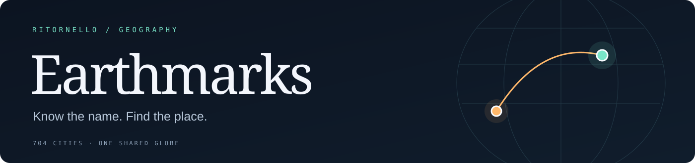
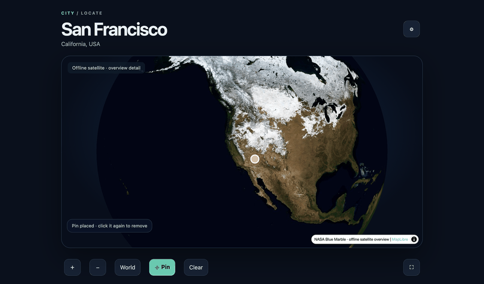
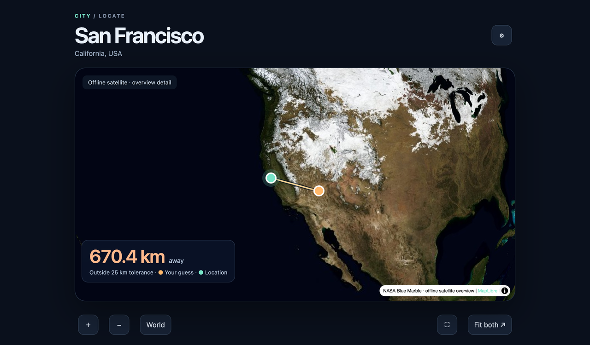

<p align="center"></p>

<p align="center"><strong>Find Places on an Interactive Globe</strong><br>
Geography you can put your finger on.</p>

<p align="center"><a href="#the-reveal">See the reveal</a> · <a href="#add-your-own-places">Add a place</a> · <a href="#getting-started">Get started</a> · <a href="https://ritornello.dev/support">Support Ritornello</a></p>

<p align="center"></p>

<p align="center"><sub>Captured in real Anki with a synthetic practice note. Orange is your guess; green is the location.</sub></p>

---

**You know the name. Can you find the place?**

Earthmarks turns a place name into a small geography challenge. Spin the satellite globe, find your bearings, and drop a pin. Reveal the answer and watch your guess meet the real location—with both points, a connecting arc, and your distance visible together.

The first edition starts with **704 curated cities**. The same template works for a mountain, a temple, or any other place you can represent with a point.

| A world you can explore | Feedback you can see | A deck you can grow |
| :--- | :--- | :--- |
| Shared **22.4 MB offline imagery** | Your guess + the answer + the distance | **Name + coordinates** is enough |

## The reveal



1. **Find it.** Rotate, zoom, and tap to place a pin. Tap your pin again to remove it. Prefer aiming with the crosshair? Leave the pin unset; the center becomes your guess when you reveal.
2. **See the gap.** The camera moves to show your guess and the answer together. The map remains interactive; **Fit both** brings you back to the comparison.
3. **Grade yourself.** The distance and your chosen tolerance help you judge your answer. Anki remains in charge of scheduling, and you choose the grade.

Borders start off, so coastlines, terrain, and spatial memory do the work. Turn borders on whenever you want a reference. Choose your default tolerance, reduce motion, or add an individual tolerance for a particular place.

## Add your own places

**No new map to draw. No new tiles to download.** Every note uses the same globe.

In Anki, choose the **Places — Globe** note type and fill two fields:

| Field | Example |
| :--- | :--- |
| **Name** | Mount Everest |
| **Coordinates** | `27.9881, 86.9250` |

Use **latitude, longitude** in decimal degrees. Negative means south or west.

That is the entire minimum. You can add the optional fields whenever they help:

| Field | What it adds |
| :--- | :--- |
| Type | City, mountain, temple, ancient site… |
| Context | A country, region, or clue that distinguishes namesakes |
| Images | A hero image and clickable thumbnail carousel; click the hero to enlarge it |
| Wikipedia URL | An optional article on the back, embedded or linked |
| Extra | Your own formatted notes on the answer |
| Tolerance km | A per-place override of your default precision |

An agent can help add new places just as easily: give it the names, verify their coordinates, and use these same fields. Additional places never need their own cartographic assets. Suggestions and corrections are welcome in [Issues](https://github.com/ritornello-labs/earthmarks/issues).

## Getting started

The first shared-deck download is being prepared. This repository contains the implementation, the 704-place seed, and the build tools; it is not yet an AnkiWeb release.

After importing a released deck, let Anki finish media sync. The globe then works offline. Wikipedia references need an internet connection.

> **AnkiDroid:** To keep your preferences between study sessions, enable **Settings → Advanced → localStorage in study screen**. Without it, the globe still works, but your preferences may reset when you leave the study screen.

### Device support

| Client | Status |
| :--- | :--- |
| Anki desktop | Tested in native Anki; requires WebGL |
| AnkiMobile on iOS | Successful user testing; preference retention across app restarts is unverified |
| AnkiDroid | Core interaction checks passed in a remote Android emulator; persistence with the setting above enabled remains unverified |
| eInk / Boox | Not recommended based on user testing |
| AnkiWeb | Not yet verified |

Preferences use device-local browser storage and do not sync with your collection. Standard desktop Anki does not retain them after a full application restart. The imagery is a global overview, with detail of a few kilometres per pixel; zooming does not reveal streets or buildings.

## Build and contribute

The card needs no add-on, JavaScript CDN, imagery API key, or per-place media. MapLibre and its worker are bundled into the template. Only optional Wikipedia references go online.

```sh
sfw npm ci
sfw uv sync --frozen
npm run build
```

The build writes templates and a synthetic preview to `out/places/`. For an offline preview, download the NASA source recorded in [`offline-source.json`](places/data/offline-source.json) to `out/places/world-nasa.jpg`, then generate the shared tiles:

```sh
uv run --frozen python places/scripts/build_offline.py
uv run --frozen python places/scripts/build.py --apkg
python3 -m http.server 8000 --directory out/places
```

Open `http://localhost:8000/preview.html`. The synthetic APKG is for disposable QA, not the 704-city release. The curated seed is in [`places.json`](places/data/places.json).

```sh
npm test
```

Browser tests cover touch-sized and desktop layouts, guess placement/removal, implicit crosshair guesses, reveal framing, antimeridian and polar cases, gallery interactions, and fresh attempts. Chromium and WebKit are used by default; set `PLACES_BROWSERS=chromium` or `PLACES_BROWSERS=webkit` to select an installed client. `PLACES_CHROMIUM` and `PLACES_WEBKIT` accept executable paths. Native QA uses [`anki-addon-workbench`](https://github.com/ritornello-labs/anki-addon-workbench) and the included workbench configuration. See [release and capture instructions](docs/RELEASING.md).

## Credits

Built by [Ritornello](https://ritornello.dev/). The globe combines **NASA Blue Marble**, **Natural Earth** reference boundaries, and **MapLibre GL JS**. The original flat-map Cities exercise is a separate skill and remains separate from Earthmarks.

Code is [MIT licensed](LICENSE). Third-party components retain their own terms; see [credits and provenance](THIRD_PARTY.md). User-added photographs and articles retain their original rights.
